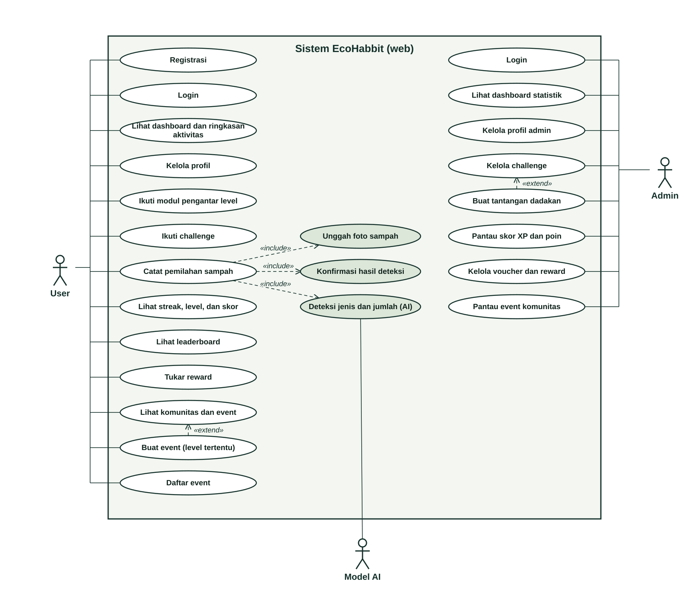

# 02 - Use Case Diagram

Versi v0.1 
Sumber kebutuhan: [01-kebutuhan-sistem.md](../01-kebutuhan-sistem.md).

File editable: [`use-case.drawio`].

Kode hanya dipakai di tabel spesifikasi dan keterlacakan; diagram sengaja tanpa kode, cocokkan lewat nama use case.

Catatan notasi:
- `«include»`: use case induk selalu menjalankan use case terkait (pemilahan sampah selalu meliputi unggah, deteksi AI, dan konfirmasi).
- `«extend»`: perilaku tambahan bersyarat (membuat event hanya bila level user memenuhi syarat; tantangan dadakan adalah perluasan dari kelola challenge).
- Login admin dan user dipisah mengikuti pembagian di notes tim; pada implementasi keduanya dapat memakai satu halaman login dengan redirect berdasarkan role.

## Spesifikasi Ringkas

### User

| ID | Use case | Prasyarat | Hasil | Kebutuhan |
|---|---|---|---|---|
| UC-U01 | Registrasi | Belum punya akun | Akun `user` dibuat pada level 1 | FR-01 |
| UC-U02 | Login | Akun ada | Sesi aktif, diarahkan ke dashboard user | FR-02, FR-03 |
| UC-U03 | Lihat dashboard dan ringkasan aktivitas | Login | Jumlah sampah, streak, ringkasan mingguan tampil | FR-05 |
| UC-U04 | Kelola profil | Login | Data profil diperbarui | FR-06 |
| UC-U05 | Ikuti modul pengantar level | Login, level terbuka | Modul tercatat selesai, refleksi tersimpan | FR-16 |
| UC-U06 | Ikuti challenge | Login, challenge aktif untuk level user | Challenge berstatus berjalan, progres dipantau | FR-18 |
| UC-U07 | Catat pemilahan sampah | Login | Pemilahan terkonfirmasi tersimpan, XP dan poin bertambah, streak diperbarui | FR-09 sampai FR-12, FR-14 |
| UC-U08 | Lihat streak, level, dan skor | Login | Streak, level, XP, poin tampil | FR-14, FR-15 |
| UC-U09 | Lihat leaderboard | Login | Peringkat tampil | FR-17 |
| UC-U10 | Tukar reward | Login, poin cukup, stok ada | Poin berkurang, kode penukaran terbit | FR-22, FR-23 |
| UC-U11 | Lihat komunitas dan event | Login | Daftar event tampil | FR-24 |
| UC-U12 | Daftar event | Login, event terbuka | User terdaftar sebagai peserta | FR-24 |
| UC-U13 | Buat event (level tertentu) | Login, level user memenuhi syarat | Event baru tampil di komunitas | FR-25 (asumsi A-01, A-04) |

### Admin

| ID | Use case | Hasil | Kebutuhan |
|---|---|---|---|
| UC-A01 | Login | Sesi admin aktif | FR-02, FR-03 |
| UC-A02 | Lihat dashboard statistik | Statistik pengguna, pemilahan, challenge, redeem tampil | FR-08 |
| UC-A03 | Kelola profil admin | Profil admin diperbarui | FR-07 |
| UC-A04 | Kelola challenge | Challenge dibuat, diubah, atau dinonaktifkan | FR-19 |
| UC-A05 | Buat tantangan dadakan | Challenge berjangka pendek langsung aktif | FR-19 |
| UC-A06 | Pantau skor XP dan poin | Skor dan riwayat poin user tampil | FR-20 |
| UC-A07 | Kelola voucher dan reward | Reward ditambah, diubah, dinonaktifkan | FR-21 |
| UC-A08 | Pantau event komunitas | Event dipantau, dapat dibatalkan | FR-26 |

### Alur utama UC-U07 (Catat pemilahan sampah)

1. User memilih Catat Pemilahan Sampah dan mengunggah foto.
2. Sistem memvalidasi file lalu mengirimnya ke Model AI.
3. Model AI mengembalikan daftar kelas terdeteksi beserta jumlahnya.
4. User meninjau hasil, dapat mengoreksi jumlah, lalu mengonfirmasi.
5. Sistem menyimpan pemilahan, menghitung XP dan poin, memperbarui streak dan progres challenge.

Alur alternatif: foto tidak valid (langkah 2), tidak ada sampah terdeteksi (langkah 3), user membatalkan (langkah 4). Diagram urutan ada di [04-ui-ux/user-flow.md](../04-ui-ux/user-flow.md).
