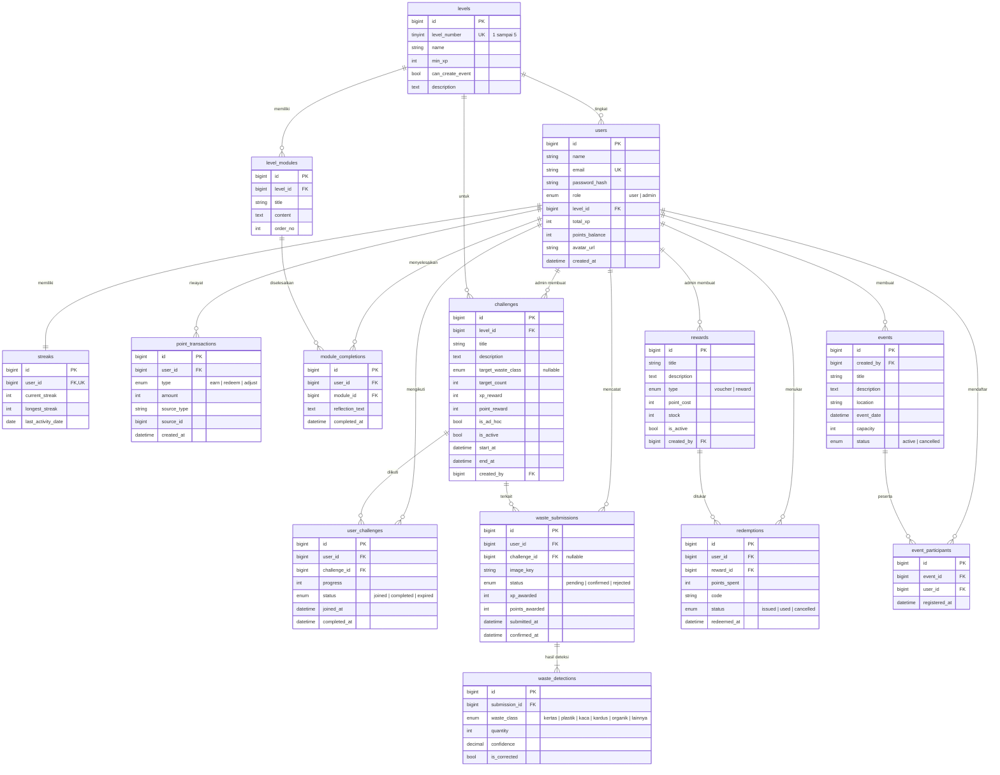

# 03 - Entity Relationship Diagram

Versi v0.1 (draft)
Kamus data: [data-dictionary.md](data-dictionary.md).

> Draft. Nama tabel, tipe, dan konvensi harus diselaraskan dengan migration tim Fullstack sebelum dipakai sebagai acuan implementasi (asumsi A-03).

## Notes Rancangan

- **RBAC sederhana:** role disimpan sebagai kolom `users.role` (`user` atau `admin`), cukup untuk dua role pada notes. Bila role bertambah, pindahkan ke tabel `roles`.
- **XP dan poin dipisah:** `total_xp` menentukan level; `points_balance` dipakai untuk reward (sesuai kebutuhan admin memantau XP dan poin). Semua perubahan poin dicatat di `point_transactions` (ledger), sehingga saldo bisa diaudit.
- **Deteksi AI menjadi baris per kelas:** satu foto menghasilkan banyak baris `waste_detections` (jenis dan jumlah). `is_corrected` menandai jumlah yang diubah user, berguna untuk evaluasi model.
- **Leaderboard tidak punya tabel:** dihitung dari `users.total_xp` (atau dari `point_transactions` per periode) dengan indeks pada kolom tersebut.
- **Streak mingguan/bulanan:** `streaks` menyimpan streak berjalan; ringkasan mingguan dan bulanan dihitung dari `waste_submissions`.
- **Event oleh user:** `events.created_by` mengacu ke `users`; hak membuat event ditentukan `levels.can_create_event` (asumsi A-01 dan A-04).
- **Foto disimpan sebagai kunci objek** (`image_key`) di object storage, bukan URL tetap, agar bisa dibuat tautan sementara.
- **Aturan XP/poin belum dibakukan** (A-05): nilai ada di `challenges` dan hasil akhirnya di `waste_submissions`, tidak dikodekan keras.
