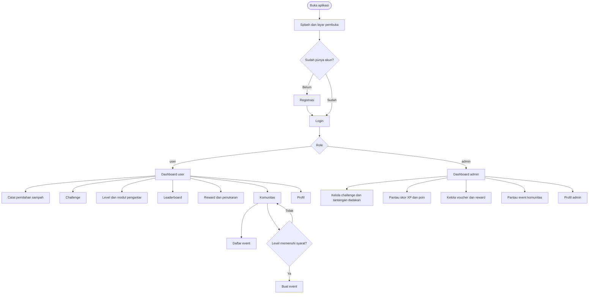
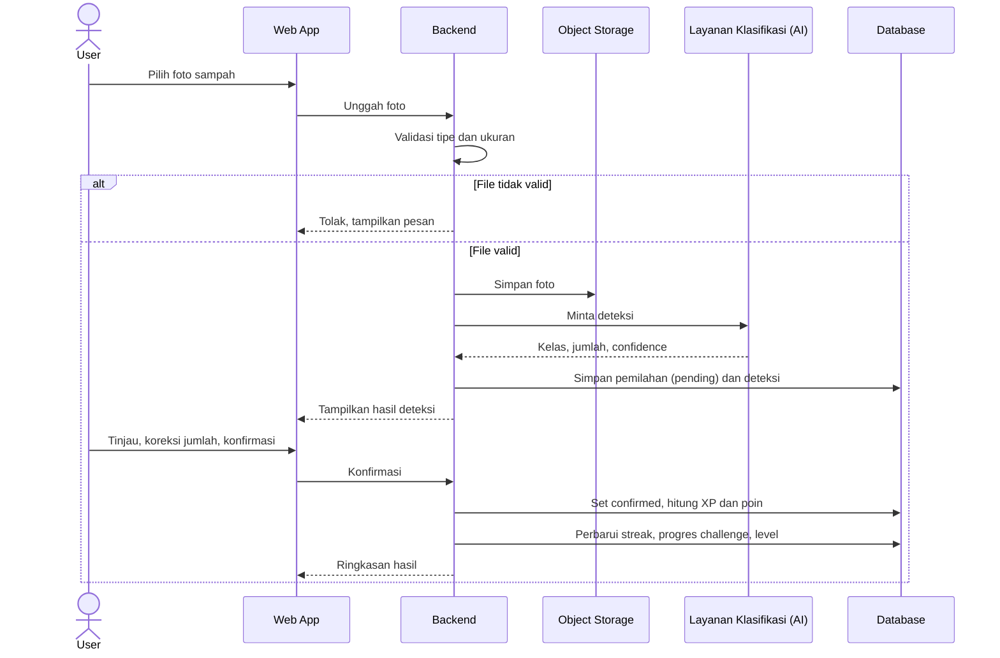
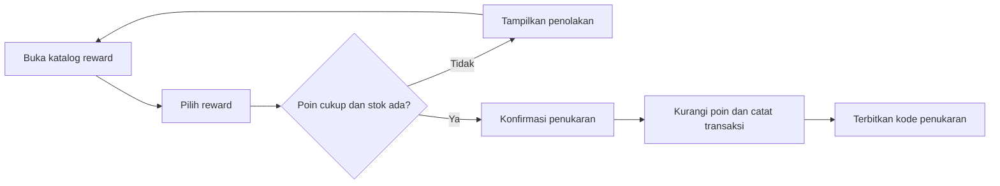

# 04b - User Flow

Versi v0.1 (draft).

## Alur Utama Aplikasi

Use case diagram menjawab "siapa bisa melakukan apa"; user flow menjawab "urutan layar yang dilalui". Alur di bawah mengikuti fitur pada notes tim.

## Alur Pencatatan Pemilahan Sampah (UC-U07)

Komponen mengikuti arsitektur Infrastructure: web app, backend, object storage, dan layanan klasifikasi.

## Alur Penukaran Reward (UC-U10)

